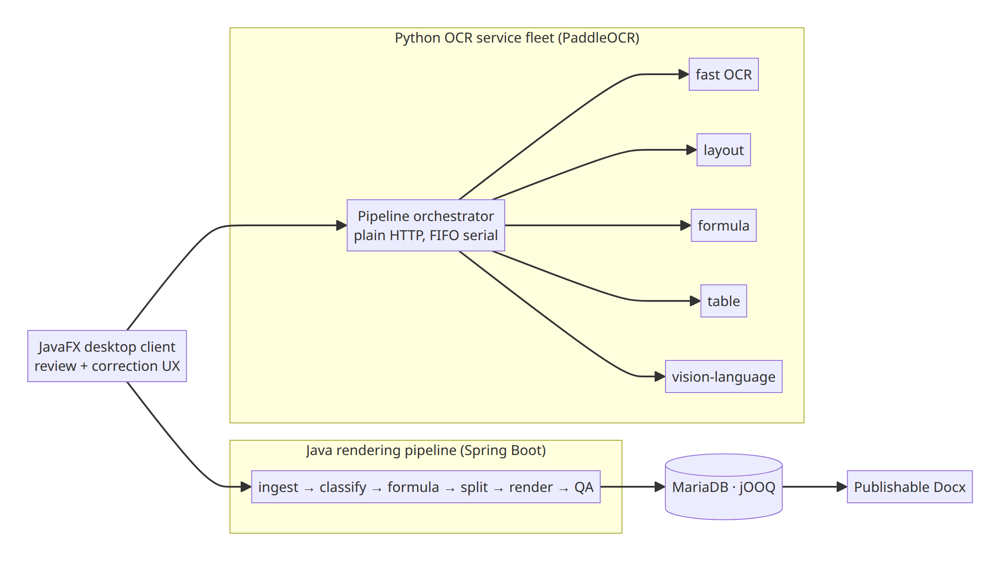
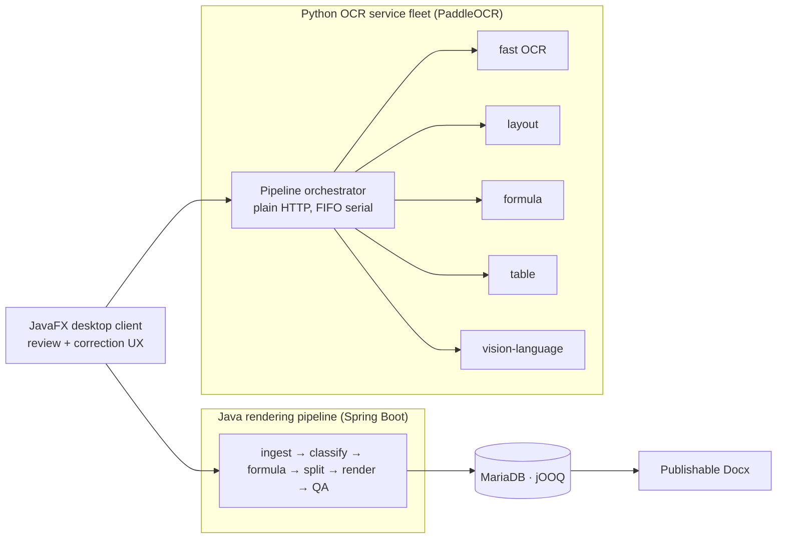

# Case Study: Exam Parser System

*Turns real exam papers (PDF/images/Docx) into structured question banks — stem/options/formulas/figures separated — and renders them back to publishable Docx. Built for educational-content production.*

**Role**: architecture owner — pipeline design, parser strategy, quality engineering.

---

## 1. System Context

view mermaid source

**Why this topology**: OCR model inference (GPU, Python ecosystem) and deterministic document rendering (POI/PDFBox, strict Docx fidelity) have opposite runtime profiles. Separate fleets keep GPU-heavy OCR horizontally swappable while the Java pipeline owns the correctness-critical transformation — and each side is tested with the tools that fit it.

## 2. Key Decisions & Rationale

### 2.1 Reverse-engineering a proprietary binary formula format (MTEF / Equation Editor 3.0)
- Hand-written byte-level parser for an undocumented format, produced by systematic probe-and-record against the legacy editor's output.
- **Design rule: never throw on unknown opcodes.** Unknown selectors are surfaced as-is and degraded *explicitly* by the writer layer (sequential concatenation), with the degradation recorded for audit — a malformed formula must never kill a whole paper conversion.
- *Rationale*: in document conversion, partial correct output with audit flags beats an exception. The parser/writer split keeps recovery policy out of the byte parser.

### 2.2 LaTeX cleanup as an ordered strategy chain
- 17 strategy classes applied serially through a registry with pre/post validation — each strategy small, order-explicit, independently testable.
- *Rationale*: formula OCR noise is a long tail of small rules. A registry chain makes the long tail additive instead of a growing tangle of if-branches, and lets fuzzing target the chain as a whole.

### 2.3 Figure-role classification as a rule chain, not a model call
- Unowned figures are short-circuited first; otherwise a rule registry plus OCR-probe evidence decides figure roles.
- *Rationale*: model calls for what rules decide cheaply keeps cost and latency predictable, and rules are explainable to human reviewers who correct classifications in the client.

## 3. Quality Engineering

~250 test files across six distinct test disciplines:

- **Fuzz tests** on the binary MTEF parser (randomized byte streams must never crash, always degrade-with-audit).
- **Metamorphic tests** on the LaTeX rewriter (transform-invariant properties verified).
- **Corpus baseline regression**: a fingerprint baseline over a real exam corpus — any rendering drift against previously-correct output fails the build.
- **Contract & E2E tests** on the full conversion pipeline, plus unit/contract coverage on the Java side; surefire parallelism tuned (a 86-case guard suite: 90s → 30s).
- **Rendered-output QA loop**: a Docx quality auditor runs post-render, closing a generate-and-audit double loop around the pipeline.

*Rationale*: for a converter, the product *is* correctness on messy real-world input. The test disciplines mirror the failure modes: fuzzing for parser robustness, metamorphism for rewriter semantics, corpus baselines against silent drift.

## 4. Honest Limitations & Trade-offs

- The OCR fleet is FIFO-serial by design (correctness and resource predictability over throughput); higher-throughput batch modes would need queueing work.
- Corpus baselines can over-fit to historical quirks; baseline updates are deliberate, reviewed events, not automatic.
- GPU fleet tuning (CUDA versions, model swaps) is operational toil outside the repository's scope.

---

*No exam content, personal data, or private fixtures are reproduced here. Numbers are from real verification runs in the private repository.*
