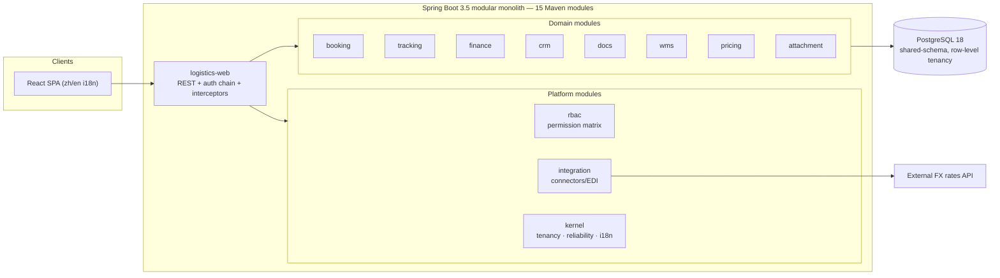
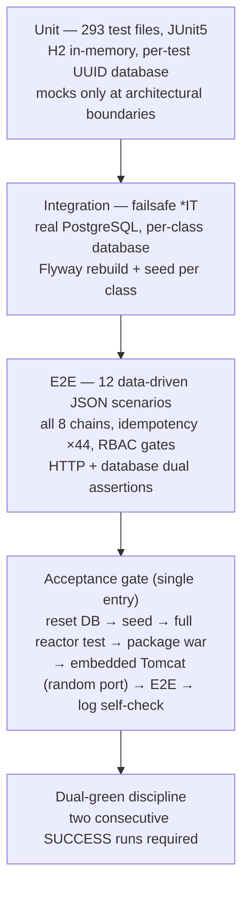
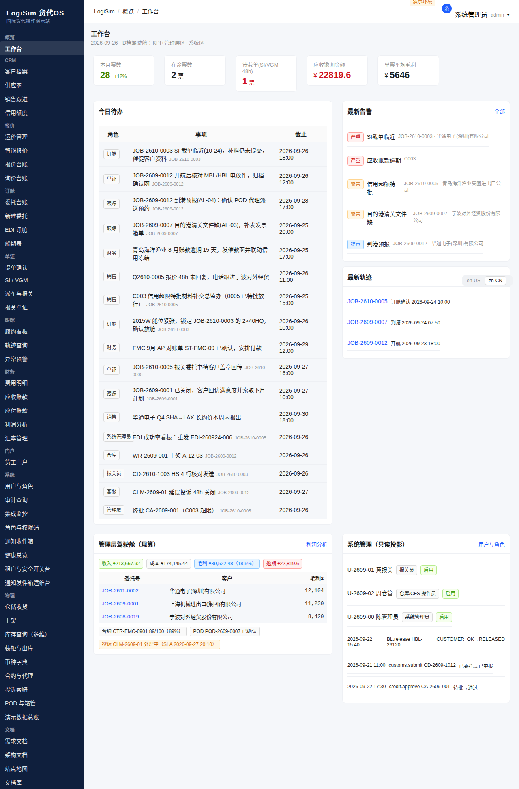
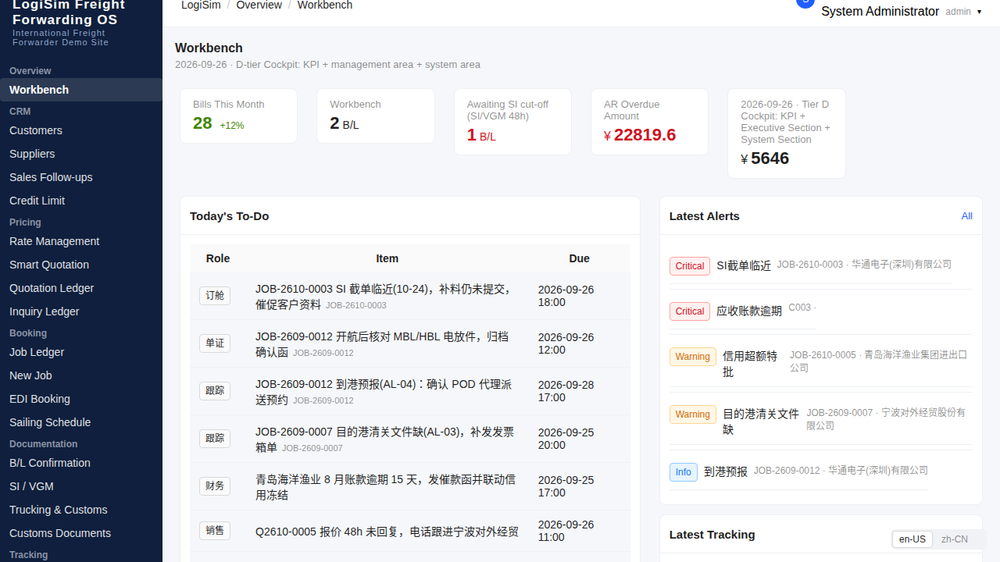
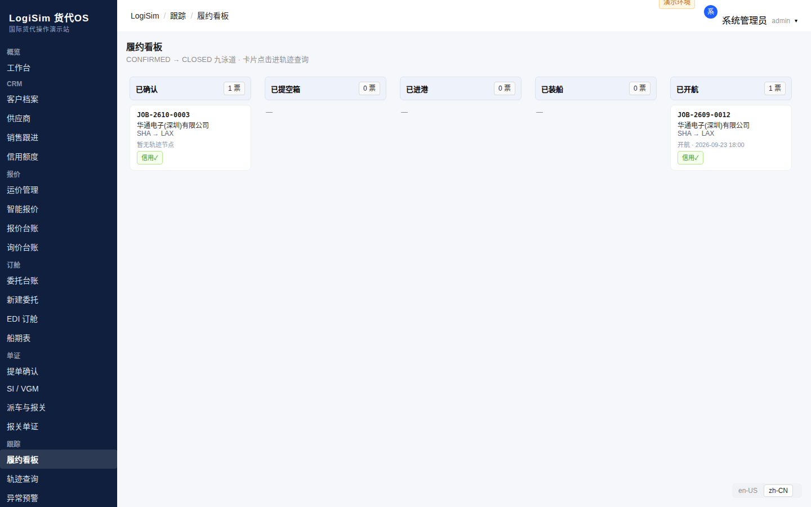
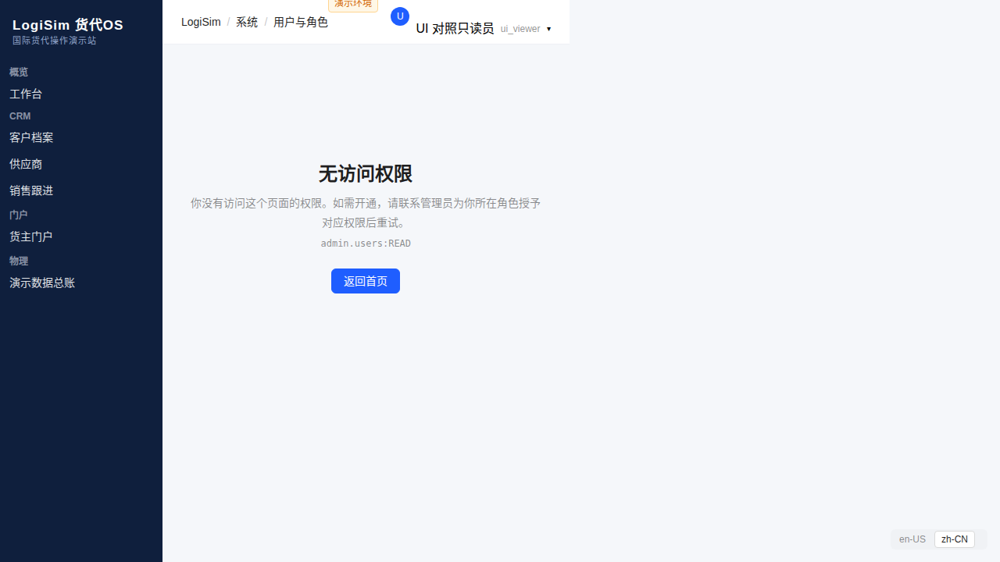

# Case Study: Multi-Tenant Logistics Management SaaS

*Freight-forwarding operations platform: inquiry → quotation → booking → SI/customs → trucking → charges/reconciliation → invoicing/settlement — eight business chains, multi-tenant, bilingual (zh/en).*

**Role**: architecture owner (requirements, architecture, task decomposition, quality gates) leading an AI-augmented engineering process.

---

## 1. System Context



> Rendered fallback: [assets/system-context.png](assets/system-context.png)

**Why a modular monolith, not microservices**: a freight-forwarding chain is a strongly-coupled transactional flow (quote → booking → SI → charges → invoice); splitting it would trade local simplicity for distributed-transaction complexity no single-tenant-scale load justifies. Module boundaries are enforced by a dedicated **archtest module (ArchUnit)** so the monolith cannot silently rot into a big ball of mud — boundary violations fail the build.

## 2. Key Decisions & Rationale

### 2.1 Tenancy: shared schema + tenant resolution choke point
- All tenant data lives in one PostgreSQL schema with a tenant column; a **tenant resolver chain** (session → header fallback, the latter strictly gated to test mode) injects tenant context once, at the request gate.
- Every query path is tenant-scoped at the data layer; cross-tenant access attempts are denied **and audit-logged** (denial reason, actor, object) before the 403 returns.
- *Rationale*: per-tenant schemas multiply Flyway migration cost and connection pools; shared schema with a single enforcement seam is cheaper to migrate and far easier to prove correct — one seam, one test family (~45 boundary assertions), instead of hoping each of 44 write endpoints remembers.

### 2.2 Authorization: permission matrix as data, not annotations
- RBAC codes (e.g. `admin.users:WRITE`) live in the DB matrix, seeded by migration; interceptors map endpoint → required code; admin/tenant/audit surfaces share the same three-state gate semantics (401 / 403 / 200).
- *Rationale*: matrix-as-data lets operators reshape roles without releases; the interceptor map is pinned by tests so a new endpoint cannot silently skip authorization.

### 2.3 Idempotency on every write endpoint
- All 44 write endpoints support a two-phase idempotency key (V24 migration); replays return the original outcome instead of double-applying.
- *Rationale*: mobile clients and integration connectors retry; retry semantics must be uniform, not a per-endpoint judgment call.

### 2.4 Reliability patterns where the chain actually fails
- Circuit breaker, bulkhead, timeout guard and retry wrappers around the external FX-rate adapter and connectors — with a dedicated reliability test suite (fixture HTTP servers, injected clocks, no real network).
- *Rationale*: the domain chain is synchronous and transactional; the unreliable parts are the edges. Patterns are applied at edges only, keeping core logic testable without scaffolding.

### 2.5 Data-layer i18n
- User-facing strings generated server-side (alert advice, notification fallbacks) are stored as i18n **keys**; resolution happens in the SPA (`t(key, locale)`), keeping translation in one place and seed data locale-neutral.

## 3. Quality Engineering (the core of this case)



> Rendered fallback: [assets/test-pyramid.png](assets/test-pyramid.png)

- **Unit**: 293 test files; H2 in PostgreSQL mode with a unique database per test — tests cannot pollute each other even if they leak state. Concurrency tests use latches and (where timing windows exist) Awaitility; a global `forkedProcessTimeoutInSeconds` kills hung forks instead of hanging CI.
- **Integration**: a `*IT` layer against real PostgreSQL — one database per test class, rebuilt by Flyway, seeded from the same SQL the acceptance gate uses. Catches what H2 cannot: real dialect behavior, real constraints, migration integrity. (A real lesson: three genuine defects — a dead boot-integration test, an authorization-gated E2E scenario, stale-frontend packaging — were all caught by this layer, not by unit tests.)
- **Acceptance**: one script, one verdict — reset → migrate → seed → full reactor `mvn test` → package → boot the WAR on a random port → run all E2E scenarios → assert port release → SUCCESS/FAIL. **Two consecutive green runs** are required before any milestone closes; a single lucky pass is not acceptance.
- **CI**: regression gate on every push/PR (full reactor). Coverage thresholds are ratcheted (JaCoCo): measure the real baseline first, then fail builds below baseline+buffer — never lower the bar.
- **Architecture & contract tests**: ArchUnit pins layering and module boundaries; a contract-test module validates REST contract assumptions against the live server.

## 4. Verification Evidence

### Product walkthrough (fictional demo data)

| Executive dashboard (zh) | Same UI in English |
|---|---|
|  |  |

| Tracking swim-lane board | RBAC guard: viewer role denied, required code shown |
|---|---|
|  |  |

The guard screen above shows the tenancy/authorization seam end-to-end: a viewer-role session hitting an admin page gets a denial page that names the exact missing permission code (`admin.users:READ`) — no silent blanks, no stack traces.

### Acceptance gate — 17-step verdict (real run output)

```text
PASS maven
PASS package
PASS server
PASS e2e/chain1-read   PASS e2e/chain1   PASS e2e/chain2
PASS e2e/chain3        PASS e2e/chain4   PASS e2e/chain5
PASS e2e/chain6        PASS e2e/chain7   PASS e2e/chain8
PASS e2e/idempotency   PASS e2e/platform-read   PASS e2e/rbac
PASS audit-immutable (update / delete / truncate)
PASS server/stop
RESULT: SUCCESS -- every step green
```

One gate, one verdict: reset DB → migrate → seed → full reactor `mvn test` → package the WAR → boot it on an embedded Tomcat (random port) → run all 12 E2E scenarios → probe audit-log immutability (update/delete/truncate must all fail) → assert port release. Milestones close only on **two consecutive** green runs.

### API example (a real case from the data-driven E2E suite)

```json
POST /chain1/inquiries          → expect 201
{
  "tenantId": "${TENANT}", "customerCode": "ACME",
  "pol": "SHA", "pod": "LAX", "containers": "1x40HQ",
  "cargoName": "electronics", "weightKg": 12000, "cbm": 55
}

response: { "rfqNo": "RFQ-…" }   // captured and chained into the next steps
```

All 12 scenario files follow this declarative shape (request → expected status/fields → captured variables), which keeps chain tests readable and reviewable as data.

## 5. AI-Augmented Delivery Process

This system was built by a **governed multi-agent process**, designed and arbitrated by a human architect:

- 20+ specialist agent roles (planner, implementers, auditors, arbitrators, final reviewer, evidence collectors) with **written iron rules**: single-target task cards, write/verify separation, face-disjoint parallel work, independent acceptance.
- **Cost circuit breakers**: per-request token budgets, output gates (no file dumps — findings cite `path:line`), measured daily against budgets; violations are recorded incidents.
- **Fake-green hunting**: test suites are mutation-verified; a "green" suite that cannot fail is treated as a defect.
- Every session closes with a ledger entry: what changed, evidence, leftovers. *No entry = not done.*

The result: production-grade, multi-tenant, fully E2E-verified software delivered at a pace that would traditionally require a small team — with the governance trail to audit every claim.

## 6. Honest Limitations & Trade-offs

- **H2 unit layer vs real PG**: unit tests run on H2 (PostgreSQL mode); dialect gaps are exactly why the real-PG integration layer exists. Migration V1–V28 is the single source of truth for schema.
- **CI integration tier is conditional**: free hosted runners cannot reach the private PostgreSQL; the integration job skips without DB credentials — the integration gate runs locally with the same dual-green discipline.
- **Monolith ceiling**: if tenant count grows past the shared-schema comfort zone, the designed seam (data layer + tenant context) is where extraction would start — documented, not yet exercised.
- **Bilingual depth**: zh is the source locale; en coverage is complete but reviewed less frequently than zh.

---

*Excerpts shown are illustrative and minimal; the private repository contains the full implementation, migrations, and test suites.*
