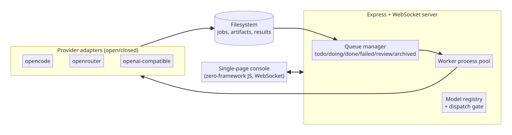
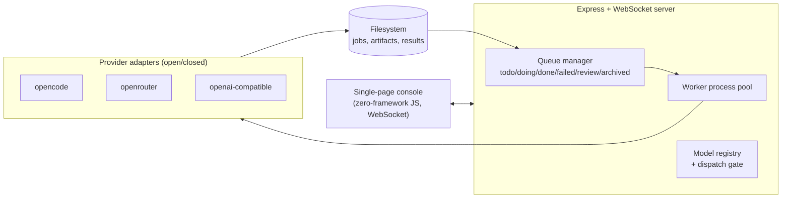

# Case Study: Multi-Agent Task Orchestration Web

*A local orchestration platform for running engineering tasks concurrently across multiple LLM providers (free/tiered models) — filesystem-backed job queue, worker process pool, and a real-time web console.*

**Role**: architect — orchestration model, reliability mechanisms, provider abstraction.

---

## 1. System Context



<details>
<summary>view mermaid source</summary>



</details>

**Why a filesystem as the persistence layer** (no Redis, no DB): jobs are files; state transitions are directory moves (six-state queue); artifacts are files on disk. For a single-node personal/team tool this means zero infrastructure, human-readable state at any moment, and crash recovery that is just *reading the directory*. The trade-off — no multi-node coordination — is out of scope by design and stated openly.

## 2. Key Decisions & Rationale

### 2.1 Dispatch gate: verify before dispatch, then cache
- Any model-targeted dispatch must pass two verification levels: a cheap list-level check, then a **real probe call** (model must respond to a trivial prompt). Failure returns 409; results are cached (two TTL layers) to avoid re-probing.
- *Rationale*: with free-model pools, "listed in the catalog" and "actually usable right now" diverge constantly (quota exhaustion, rate limits). Probing truth beats trusting the catalog, and caching keeps the gate cheap.

### 2.2 Artifact reconciliation: never trust the model's report
- Completion is decided by a **pure function over the filesystem** (artifact timestamps/sizes), not by the worker's textual claim. A worker that did work but failed to report is routed to `needs_review` instead of being retried into duplicate work.
- *Rationale*: LLM-reported status is unreliable by nature. Making the filesystem the source of truth converts "the model says it's done" into a checkable fact — this is the single most transferable design idea in the project for anyone building on LLMs.

### 2.3 Provider abstraction by open/closed principle
- Adding a provider = adding one adapter file; the registry auto-discovers and routes by model-ID prefix. Workers handle rate limits with exponential backoff.
- *Rationale*: provider churn is the constant in the LLM market; the system must absorb new providers without core changes.

## 3. Quality Engineering

Three test layers, deliberately kept cheap and offline:

- **Unit tests** for the artifact-reconciliation pure functions and provider adapters — no model calls, no network.
- **Static + runtime self-checks**: syntax verification and DOM-level runtime checks for the zero-framework frontend.
- **Smoke gates**: an API-level smoke suite as a merge gate, plus an optional full-chain smoke with real inference (explicitly not in the default gate, since it costs real quota and time).

Real output from the offline suite (`npm test`, no model calls, no network):

```text
✅ validateCreate kind 反例：bogus/大小写错/带空白/null/非串 → 逐条 ok:false（仅 debate|review）
✅ 向后兼容：kind 缺省视为 debate，validateCreate 既定错误语义与顺序逐字未变
✅ reviewSummary 混合计数：1/2/1/1 → total5 四桶正确；未知 severity 只进 total（不进桶）
✅ reviewSummary 非数组入参：throw TypeError（不静默返回全 0）
debate-state-machine: 30/30 通过
```

Note the assertion discipline in the names: compatibility is asserted *verbatim* ("逐字未变"), and error paths must throw — never silently return zeros.

## 4. Honest Limitations & Trade-offs

- Single-node only: the filesystem-as-queue design intentionally forfeits distributed coordination.
- Security posture assumes a trusted LAN/host: token-based auth exists, but the default binding is for local use, not public exposure.
- The zero-framework frontend keeps dependencies at zero but caps UI complexity; a framework would be justified if the console grows.

---

*No keys, credentials, or internal task briefs are reproduced here. The private repository contains full implementation and test suites.*
